<p align="center">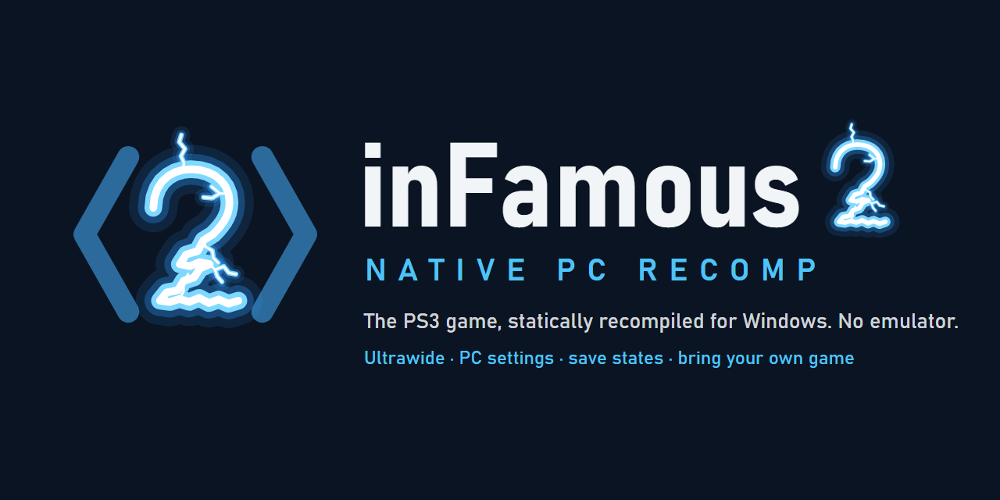</p>

# inFamous2Recomp

A native Windows build of Sucker Punch's *inFamous 2* (PlayStation 3, 2011), made by **statically
recompiling** the game's own PowerPC and SPU code into C++ with the
[ps3recomp](https://github.com/sp00nznet/ps3recomp) toolkit and compiling that into a Windows
executable. There is **no emulator** underneath: the game's code runs as x86-64 code, the PS3's system
libraries are reimplemented, and the RSX graphics chip's commands are translated to Direct3D 12.

**You need your own copy of the game.** This repository contains no game code, no game assets, no
firmware, no keys and nothing generated from them. You build the executable on your own PC from your
own disc and title update; the result stays on your machine.

Target: **BCUS98125** (North America), **title update 1.04**.

## Screenshots

Captured from the port running on Windows (2560x1080 monitor); cropped and resized only.

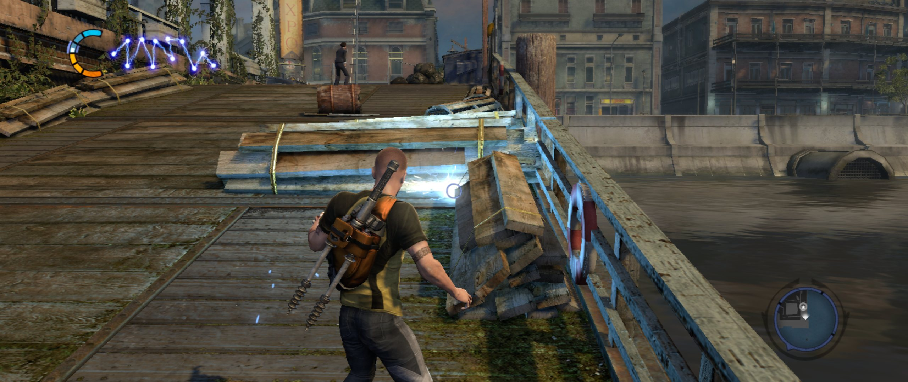
*True ultrawide (Hor+, 64:27) in borderless fullscreen at 2560x1080: Cole firing a bolt on the New Marais pier, HUD spread to the screen edges.*

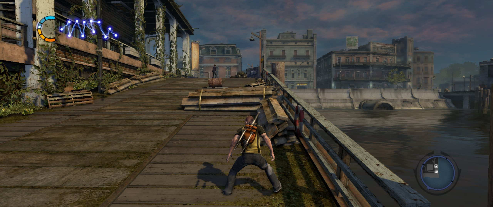
*New Marais from the pier, right after the boat ride (ultrawide).*

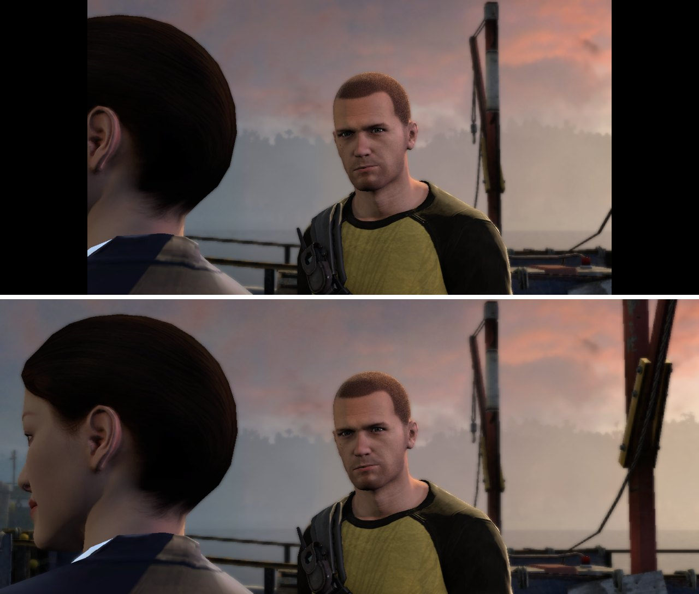
*The same cutscene frame: stock 16:9 (`aspect = off`, top) and Hor+ ultrawide (`aspect = auto`, bottom) -- same vertical view, more at the sides.*

| | |
|---|---|
| 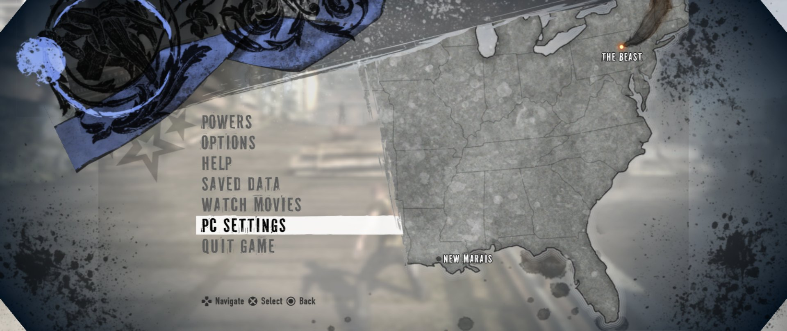 | 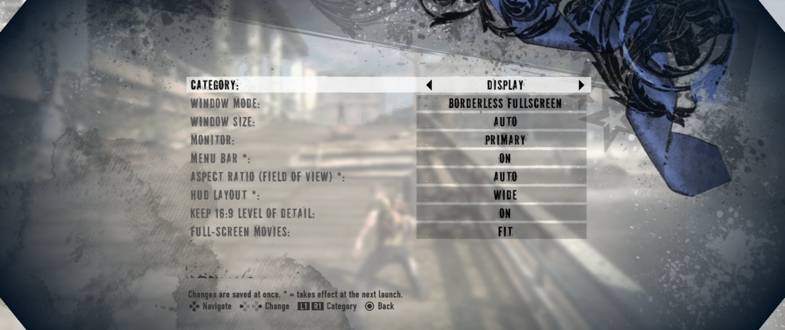 |
| *The game's own pause menu gains **PC Settings** and **Quit Game**.* | *PC Settings, Display: window mode, aspect ratio (field of view), HUD layout, LOD, movies.* |
| 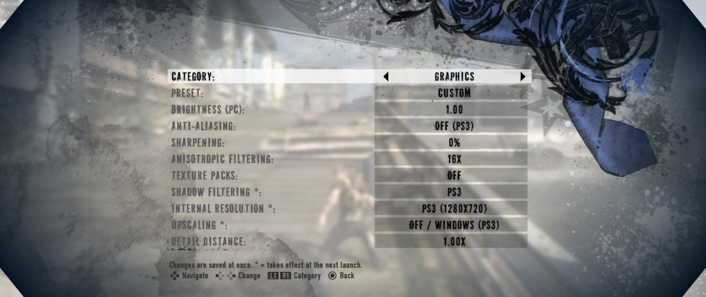 | 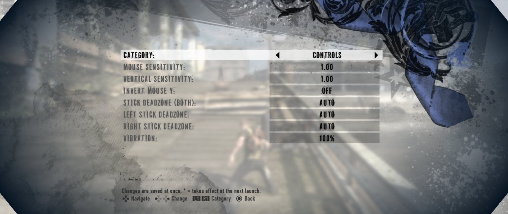 |
| *Graphics: preset, brightness, anti-aliasing, sharpening, AF, texture packs, shadow filtering, internal resolution, upscaling.* | *Controls: mouse sensitivity, stick deadzones, vibration.* |
| 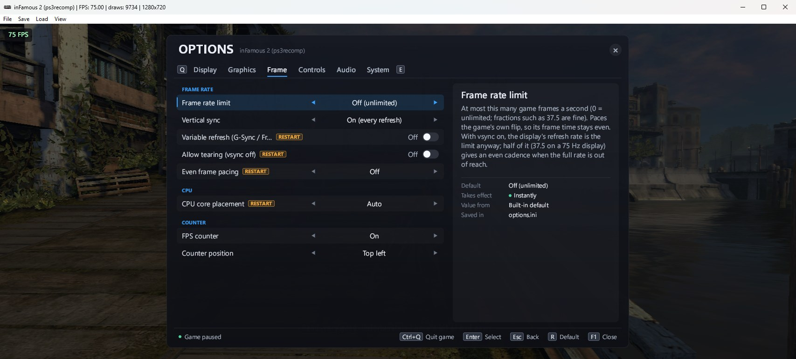 | 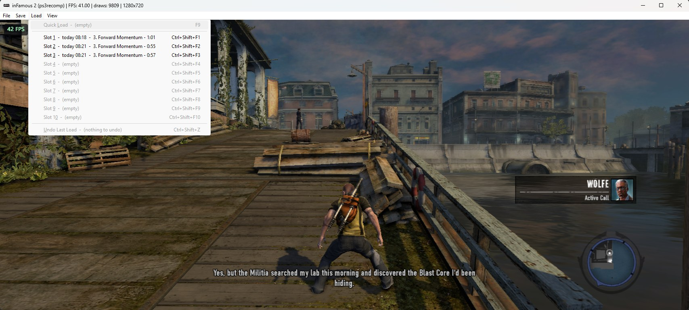 |
| *The F1 options overlay (Frame tab: frame-rate limit, vsync, VRR, frame pacing, FPS counter), windowed with the FPS counter on.* | *The window's **Load** menu: save-state slots labelled with time, mission and play time.* |

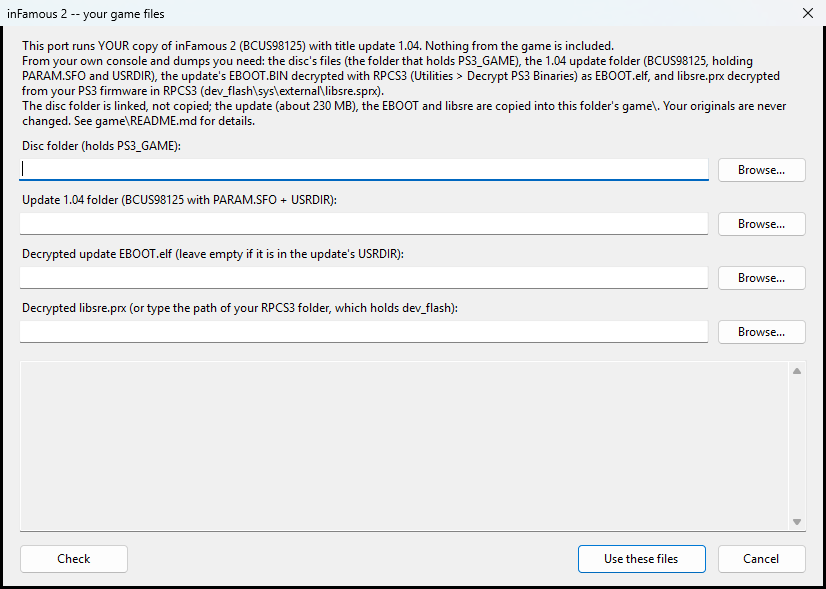

*The launcher's first-run game-files screen. After that it checks the build tools, builds, and starts the game.*

## Features

- **The PS3 game, natively on PC:** the game's own saves (in the PS3 format: they copy to and from
  RPCS3), its HDD install, movies and audio, the 1.04 update's content; DLC unlock files work with your
  own licence (`game/README.md`).
- **Ultrawide and any window shape.** True Hor+ widescreen: the game renders a wider view (same vertical
  view, more at the sides), the HUD spreads to the screen edges (or stays 16:9), movies are fitted;
  `auto` follows the monitor (21:9, 32:9, 16:10, 4:3, any W:H). Resizable window and borderless
  fullscreen (F11 / Alt+Enter). `config/display.ini`.
- **Controllers.** Xbox / XInput pads, DualShock 4, DualSense and DualSense Edge, DualShock 3, Switch Pro
  and "Switch mode" pads, other HID gamepads -- over USB or Bluetooth, hot-plugged. Motion (SIXAXIS),
  rumble, lightbar and player LEDs, pressure-sensitive buttons where the pad has them; remapper copies
  (Steam Input, DS4Windows, ...) are recognised so one pad never shows up twice. `docs/CONTROLLERS.md`.
- **Keyboard and mouse,** at the same time as a controller, fully rebindable, with mouse camera and
  sensitivity settings. `config/input.ini`.
- **Save states.** Save the whole game at any moment and load it back in a fraction of a second: F5 / F9
  quick slot, ten slots on Ctrl+F1..F10, labelled with the mission and play time, Undo last load.
  `docs/SAVESTATES.md`.
- **Options in the game.** F1, the PS / Guide / Home button or L3+R3 opens the PC options overlay
  (display, graphics, frame rate, controls, audio, system), and the game's own pause menu gains
  *PC Settings* and *Quit Game*: frame-rate cap and frame pacing, variable refresh, anisotropic
  filtering, anti-aliasing and sharpening, upscaling filters, shadow filtering, an FPS counter, volume
  and more -- applied live and saved to `config/options.ini`.
- **Performance work.** RSX command processing with a separate render thread, lifted and
  register-cached SPU job code, shader and pipeline caches (no compile hitches after the first time),
  write-watched texture caching, CPU core placement for big-cache CPUs. On the test PC (Ryzen 7 9800X3D,
  RTX 5080) the heaviest prologue fight measures about 50 fps and New Marais streets 60+ fps; the PS3
  version runs at up to 30.
- **Texture dumps and replacement packs** (`tools/texpack/README.md`) and **resolution scaling**
  (experimental).
- **Problem reports built in:** every play session writes a small issues file (stutters, slow
  stretches, crashes, F8 marks with a screenshot) that holds no personal names; `py tools\play_triage.py`
  ranks them.

## What you need

- **Your own inFamous 2 (BCUS98125)** dumped from your own disc, plus **title update 1.04** installed
  from your own console or PSN (the updates in order, or their 1.04 files).
- **RPCS3** (free) to decrypt two files you own: the update's `EBOOT.BIN` -> `EBOOT.elf`, and the
  firmware's `dev_flash/sys/external/libsre.sprx` -> `libsre.prx` (install the official PS3 firmware in
  RPCS3 first). Step by step: [game/README.md](game/README.md).
- **A Windows 10/11 x64 PC** with a **Direct3D 12** GPU. A modern 8-core CPU is recommended: the game's
  SPU work runs on CPU cores. About **20 GB** of free disk space (the disc stays where it is; the build
  takes about 5 GB and the game's own HDD install about 2.5 GB).
- **Build tools** -- the launcher checks them and offers to install missing ones with winget:
  Git for Windows (with Git Bash), Python 3.10+, CMake 3.20+, Ninja, Visual Studio 2022 Build Tools
  with the C++ workload, LLVM (`clang-cl`).

## Quick start with the launcher

1. Get this repository (the source archive or `git clone`) into a folder of its own, e.g.
   `C:\Games\infamous2-recomp`, and put `inFamous2Launcher.exe` in that folder (it comes with a release;
   or build it in a second with `tools\build_launcher.cmd`, which uses the C# compiler built into
   Windows).
2. Run **`inFamous2Launcher.exe`**. The first time, it asks for your files:
   - the **disc folder** (the one holding `PS3_GAME`),
   - the **update 1.04 folder** (`BCUS98125`, holding `PARAM.SFO` and `USRDIR`),
   - the **decrypted update `EBOOT.elf`** (if it is not already in that `USRDIR`),
   - the **decrypted `libsre.prx`** (or the path of your RPCS3 folder).

   It checks them (title, update version, the EBOOT's SHA-1, nothing still encrypted), links the disc
   into `game\` and copies the small update, the EBOOT and libsre there. Your originals are not changed.
3. Under **Build tools**, anything missing has an **Install** button: it shows you the exact
   `winget install` command and runs it only if you confirm. Then press **Check again**.
4. Press **Build and play**. The launcher runs the repository's own pipeline (`tools\build.ps1`) one
   step at a time, with a progress bar, the current step, the elapsed time and a live log (also saved
   to `logs\launcher-<time>.log`): *fetch and patch the toolkit* -> *check your files* -> *analyze* ->
   *translate the code to C++* -> *translate the SPURS library* -> *translate the SPURS jobs* ->
   *compile*. On the 16-thread test PC the whole first build took about 4 minutes, mostly the
   compile; expect longer on smaller PCs. **Cancel** stops it; the next run
   continues from the step that was interrupted.
5. When the build succeeds, the game starts by itself. Its first start installs part of the disc into
   `game\hdd0` (as on a PS3); later starts are quick.

Next time the button says **Play**: nothing is rebuilt unless the sources, the toolkit pin or patch, or
your files changed. **Rebuild** runs every step again; **Open logs** and **Open game folder** do what
they say. If a step fails, the launcher shows the end of its log; fix the cause and press **Retry**:
finished steps are not run again.

The launcher fetches the ps3recomp toolkit from GitHub with git during its first step; it downloads
nothing else by itself. You can also start the built game directly: double-click `build\infamous2.exe`.

## Building by hand

Everything the launcher does is in plain scripts:

```bat
:: your files -> game\  (layout and decryption: game\README.md)
:: everything: toolkit, check, analyze, lift, libsre, jobs, compile
powershell -ExecutionPolicy Bypass -File tools\build.ps1

:: one step: setup | check | analyze | lift | libsre | jobs | build
powershell -ExecutionPolicy Bypass -File tools\build.ps1 -Step check

:: just recompile after changing src\ or the toolkit
powershell -ExecutionPolicy Bypass -File tools\build.ps1 -BuildOnly

:: play (log: logs\run-<time>.log); or double-click build\infamous2.exe (logs\play-<time>.log)
powershell -ExecutionPolicy Bypass -File tools\run.ps1
```

`tools\build.ps1 -Disc` builds the 1.00 disc EBOOT instead of the update. Build options (PGO, speed
switches) are described at the top of `tools\build.ps1` and in `CMakeLists.txt`.

For developers: the toolkit test `test_ss_fsfd` needs the PS3's SDAT key, which this repository does not
ship. Give it as `PS3_SDAT_KEY=<32 hex digits>` or a git-ignored `sdat.key` file in the directory you start
it from; without one it prints `test_ss_fsfd: skipped: no SDAT key` and passes. The game does not need it.

```
your disc + update ──RPCS3 decrypt──▶ EBOOT.elf, libsre.prx
        │
 tools/check_inputs.py   validate SFO / ELF / SHA-1, pick the update EBOOT
 tools/analyze.sh        functions, firmware imports, coverage report, SPU images
 tools/relift.sh         PowerPC + SPU ──▶ C++ in generated/
 tools/lift_libsre.sh    the real SPURS library, from your firmware
 tools/lift_jobs.sh      SPURS policy modules, job modules, job chains
 cmake + ninja           + ps3recomp runtime (PS3 OS, libraries) + RSX ──▶ Direct3D 12
        │
        ▼
 build\infamous2.exe     assets read from game\disc and game\hdd0 at run time
```

## Playing, quitting and reporting problems

- **Quit:** open the options (F1, the PS / Guide / Home button, or L3 + R3 held) and press △ / Y twice
  (Ctrl+Q twice on the keyboard), or use *Quit Game* in the pause menu. Alt+F4 and the window's close
  button work too. A save the game is writing finishes first.
- **Something looks wrong?** Press **F8**: the moment is marked in the session's issues file and a
  screenshot is saved beside it.
- **Reporting:** send `logs\play-<time>-issues.txt` and any `-markN.png`. After a crash there is also a
  `-crash.dmp`: useful, but it contains your Windows user name in file paths.
  `set PLAY_ISSUES=0` turns the issues file off.
- Save states (`savestates\`), texture dumps and the game's saves (`gamedata\`) are made from your copy of
  the game: never share or commit them.

## Status and known issues

The prologue and the opening of New Marais have been played and tuned on the test PC with the features
above; **a full playthrough has not been verified yet.** It is a young port; expect rough edges:

- Only **BCUS98125** with **update 1.04** (or its 1.00 disc EBOOT) is supported; other regions and the
  updates 1.01-1.03 have no title-specific values and are refused.
- **Windows only.** The toolkit builds on Linux, but there is no renderer there.
- **CPU-bound.** The SPU work runs on CPU cores; weaker CPUs see lower frame rates in heavy scenes.
  The game logic is the PS3's (a 30 fps design); the frame-rate cap is in the options.
- Resolution scaling is experimental; only one anti-aliasing mode (Fast) exists.
- Windows' **Smart App Control** can block a freshly built, unsigned `infamous2.exe`. It is a setting of
  your PC (turning it off cannot be undone without resetting Windows): your decision.
- Open items and the full development history: `docs/NOTES.md` (the engineering journal, newest first)
  and `docs/ROADMAP.md`.

## Repository layout

| Path | What |
|---|---|
| `launcher/` | the launcher's source; `tools\build_launcher.cmd` builds `inFamous2Launcher.exe` |
| `src/` | the port: runner, title hooks, menus, checkpoints, clocks |
| `tools/` | the pipeline, the run script, diagnostics |
| `patches/ps3recomp/` | the changes to the ps3recomp toolkit, applied by `tools/setup.ps1` |
| `config/` | display, input and save-state settings (`options.ini` is written by the game) |
| `docs/` | controllers, save states, ground truth, roadmap, the engineering journal |
| `game/` | **your** files (git-ignored; see `game/README.md`) |

## Legal

- This project is **not affiliated with, endorsed or sponsored by Sony Interactive Entertainment or
  Sucker Punch Productions.**
- inFamous, PlayStation, PS3, DualShock and DualSense are trademarks of Sony Interactive Entertainment;
  other trademarks belong to their owners and are used only to describe compatibility.
- **No game code, assets, firmware or keys are included**, nor anything derived from them. The build
  translates the code of a copy you own, on your PC, for your own use. **You must own the game** and its
  update and dump them yourself. Do not share the built executable, `generated\`, `analysis\`, save
  states or dumps: they contain the game's code or data.
- The source code is MIT-licensed (`LICENSE`); third-party code and credits: `THIRD_PARTY.md`.

## Author and support

Made by **bhuiyah**. If you enjoy it, you can support the work on Patreon:
<https://www.patreon.com/cw/bhuiyah>. On Reddit: u/Sajthetaj.

## Credits

- **ps3recomp** by Ned Heller (sp00nznet) and its contributors -- the toolkit this port is built on (MIT).
- **RPCS3** -- for the decryption players need and for years of PS3 research.
- **Sucker Punch Productions** -- for *inFamous 2*.
- bhuiyah and the infamous2-recomp contributors. Toolkit fixes go upstream to ps3recomp where they help every port;
  only inFamous-2-specific behaviour lives here.
